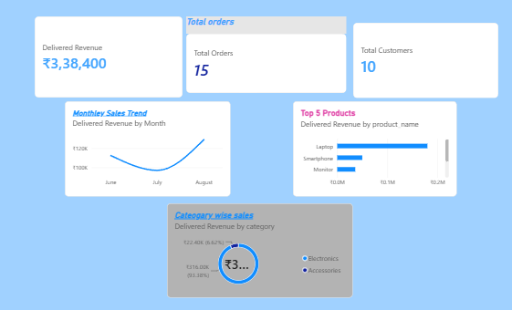

# Retail Sales Analysis Using MySQL & Power BI

## Project Overview
This project analyzes retail sales data using MySQL and Power BI to understand sales performance, customer purchasing behavior, and product profitability.

## Tools Used
- MySQL 8.0
- MySQL Workbench
- SQL
- Power BI Desktop

## Database Tables
1. Customers
2. Products
3. Orders
4. Order_Items

## SQL Concepts Used
- SELECT and WHERE
- Aggregate Functions (SUM, COUNT)
- JOIN
- GROUP BY
- ORDER BY
- LIMIT
- Date Functions

## Business Analysis
- Total customer and product count
- Delivered revenue analysis
- Monthly revenue analysis
- Top-selling products
- Top customers by spending
- Product-wise profit analysis

## Power BI Dashboard
Created an interactive dashboard to visualize retail sales performance.
## Dashboard Preview

### Dashboard Features
- Total Revenue
- Total Orders
- Total Customers
- Monthly Sales Trend
- Top 5 Products by Revenue
- Category-wise Sales

**Power BI File:** `customer name.pbix`

## Key Findings
- Total customers: 10
- Total products: 10
- Total orders: 15
- Delivered revenue: ₹3,38,400
- Headphones sold: 7 units
- Rahul was the top customer in the analysis.
- Laptop generated the highest product profit.

## Dataset
This project uses a small, fictional dataset created for SQL learning and portfolio practice.

## Author
Aspiring Data Analyst
